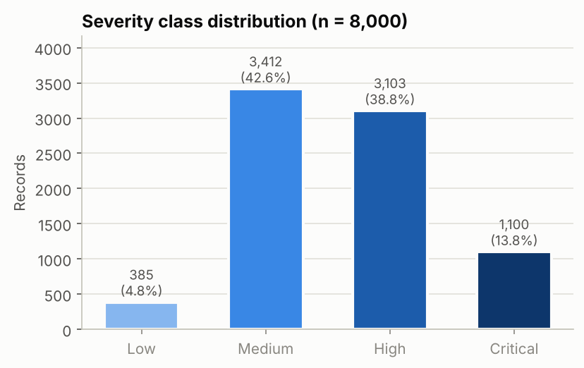
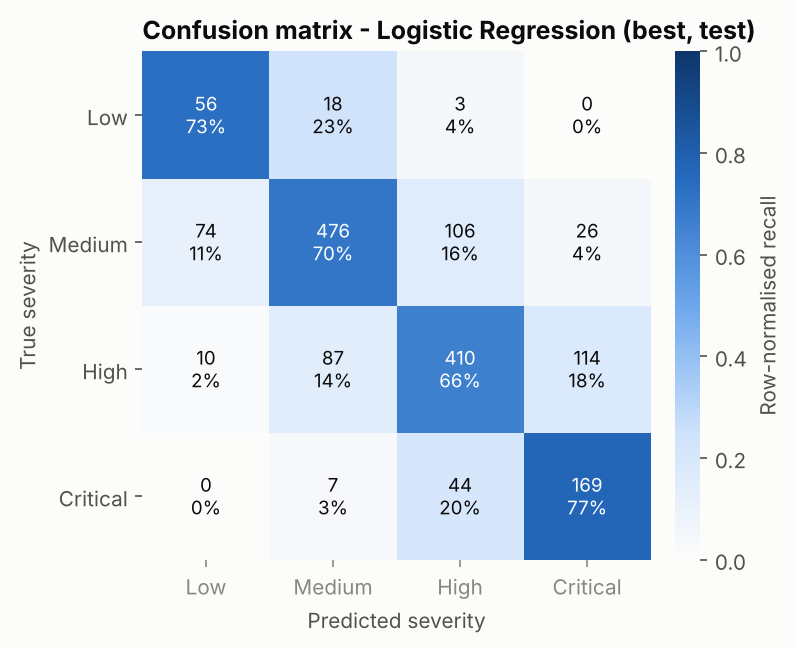
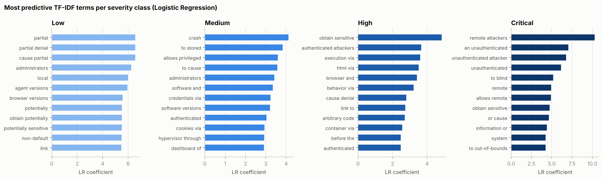

# Predicting Vulnerability Severity from CVE Descriptions

A small, fully reproducible research project. It predicts a vulnerability's
**CVSS v3.1 qualitative severity (Low / Medium / High / Critical)** from its
free-text, CVE-style description, using TF-IDF features and classical
scikit-learn classifiers. No deep learning, no downloads. The whole pipeline
runs in about 3 minutes on a 4-vCPU machine.

- **Paper:** [`paper/paper.md`](paper/paper.md)
- **Results:** [`results/`](results/) (CSV metrics + figures)
- **Code:** [`src/`](src/)

## Headline results (held-out test set, n = 1,600)

| Model | CV macro-F1 (train, 5-fold) | Test accuracy | Test macro-P | Test macro-R | Test macro-F1 [95% CI] |
|---|---|---|---|---|---|
| Majority baseline | 0.150 | 0.426 | 0.107 | 0.250 | 0.149 [0.143, 0.156] |
| Complement NB | 0.466 | 0.618 | 0.455 | 0.460 | 0.452 [0.429, 0.475] |
| **Logistic Regression** | **0.625** | 0.694 | 0.621 | **0.713** | **0.649** [0.620, 0.676] |
| Linear SVM | 0.610 | 0.684 | 0.611 | 0.674 | 0.634 [0.604, 0.662] |
| Random Forest | 0.612 | **0.698** | **0.638** | 0.641 | 0.639 [0.609, 0.670] |

Logistic regression is selected on CV macro-F1. It is not reliably better than
the random forest (it wins in 77% of paired bootstrap resamples). 90.6% of its
errors are off by one severity level. Given the *true* CVSS vector instead of
the text, a classifier reaches 0.997 accuracy. The remaining gap is therefore
caused by information that the description does not contain.

| Class distribution | Confusion matrix (best model) |
|---|---|
|  |  |



## Quick start

```bash
python -m venv .venv && source .venv/bin/activate   # optional
pip install -r requirements.txt
python -m src.run_pipeline          # regenerates data/, results/ (~3 min)
python -m unittest discover -s tests -t .   # CVSS calculator sanity tests
```

`python -m src.generate_data` regenerates only the dataset and prints a few samples.

## Repository layout

```
src/
  config.py         seed, paths, sizes (single source of truth)
  cvss.py           CVSS v3.1 base-score calculator + severity bands
  generate_data.py  synthetic CVE-description generator (documented below)
  features.py       TF-IDF configurations (word / char n-grams)
  models.py         sklearn pipelines + small hyper-parameter grids
  evaluate.py       metrics, ordinal error stats, bootstrap CIs
  plots.py          matplotlib figures
  run_pipeline.py   end-to-end experiment driver
tests/test_cvss.py  reference-vector tests for the CVSS calculator
data/cve_synthetic.csv            generated dataset (8,000 rows, deterministic)
results/metrics_summary.csv       per-model headline metrics + CIs + best params
results/per_class_metrics.csv     per-class precision / recall / F1 / support
results/confusion_matrices.csv    test confusion matrices, all models
results/ablation_features.csv     TF-IDF feature-set ablation (logistic regression)
results/top_terms_per_class.csv   top-20 LR terms per class
results/error_by_vuln_class.csv   best-model accuracy per weakness family
results/misclassified_examples.csv  sample of test errors
results/summary.json              oracle ceiling, subset analyses, paired bootstrap, runtime
results/figures/*.png             class distribution, confusion matrices, top terms, model comparison
paper/paper.md                    the write-up
```

## Design decisions

**Why synthetic data?** Real CVE data (NVD API 2.0) requires paging through
hundreds of thousands of records under strict anonymous rate limits. Bulk JSON
feeds have been retired or moved over time, so a download "without auth, in
under 10 minutes, reliably" could not be guaranteed. The task brief prefers a
documented synthetic set in that case. The generator is built to keep the
*causal structure* of real data, not just its vocabulary:

1. Sample a weakness family (19 CWE-like classes: command injection, XSS, SQLi,
   memory corruption, DoS, info disclosure, auth bypass, ...). Class priors
   roughly follow NVD frequencies.
2. Sample a **latent CVSS v3.1 vector** from class-conditional distributions.
   For example, XSS is mostly `UI:R/S:C/C:L/I:L/A:N` and privilege escalation is
   mostly `AV:L/PR:L/C:H/I:H/A:H`.
3. Compute the **official CVSS v3.1 base score** (`src/cvss.py`, unit-tested on
   reference vectors) and map it to the severity band. The label is never
   assigned by hand.
4. Render a description in one of four NVD-like templates. Each metric is only
   **partially observable**: the actor phrase that reveals AV/PR appears 80% of
   the time, the attack vector / user interaction phrase 75%, the
   attack-complexity caveat 70%. About 10% of records use a vague template
   ("A vulnerability in X ... may lead to a security impact").
5. **Analyst-disagreement noise:** for 5% of records, one hidden metric is
   re-sampled *after* the text is written, so text and score disagree.
6. Vendor and product names are random 4–5-syllable pseudo-words. They carry no
   signal and do not name real software. Exact-duplicate descriptions are
   removed.

The result is a class mix close to NVD's (Low 4.8%, Medium 42.6%, High 38.8%,
Critical 13.8%) and a task that is learnable but not trivial.

**Modelling.** Every classifier is an sklearn `Pipeline(TfidfVectorizer -> clf)`,
so TF-IDF is fit only on training folds and nothing leaks from the test set.
Settings: word 1–2-grams, sublinear TF, `min_df=2`, and a token pattern that drops
version numbers. Hyper-parameters come from a small grid with 5-fold stratified CV
on the 80% training split, scored on macro-F1. **Model selection uses CV, never
the test set.** Supervised models use balanced class weights because Low and
Critical are minorities.

**Evaluation.** Metrics: accuracy, macro precision/recall/F1, per-class metrics,
and confusion matrices. Because severity is ordinal, we also report ordinal MAE,
the share of errors that are off by one level, and the "severe error" rate
(≥ 2 levels off). Uncertainty comes from 1,000 bootstrap resamples of the test
set, plus paired bootstrap comparisons between models.

**Extra analyses.** These are a TF-IDF feature ablation, an *oracle* classifier
trained on the true CVSS metrics (the information ceiling), accuracy on the
vague-template and noisy-label subsets, and per-weakness-family error analysis.

**Reproducibility.** One seed (`config.SEED = 42`) controls generation, the
split, CV folds, models and bootstrap. Two consecutive runs gave identical
numbers. A different library version may change the last digits.
