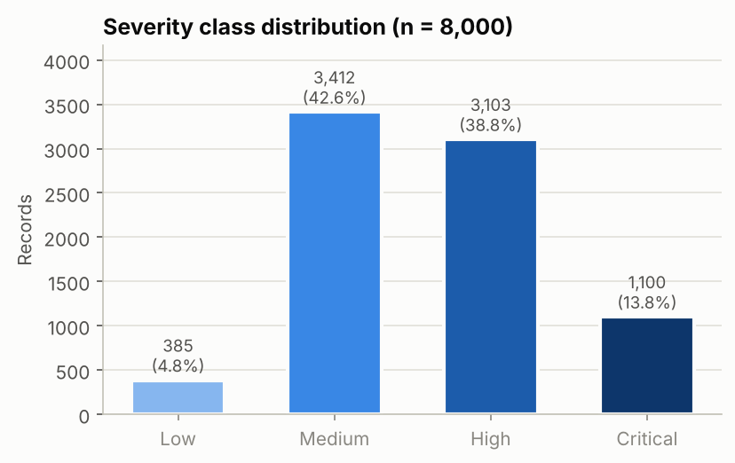
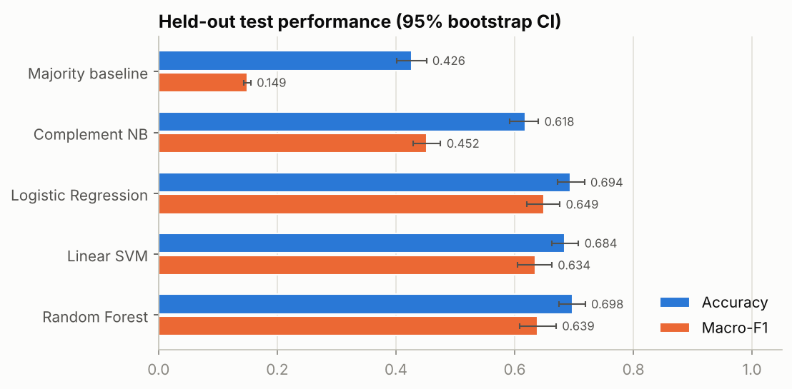
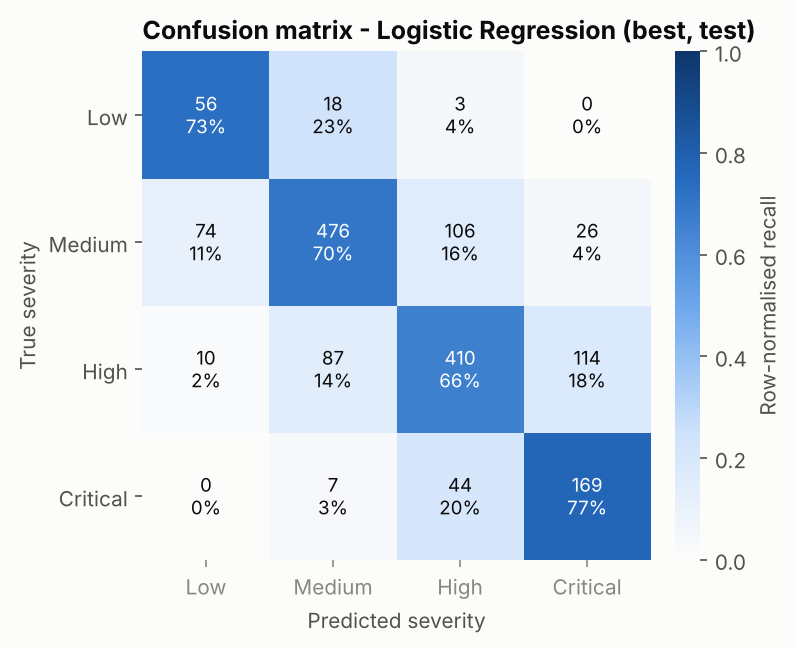
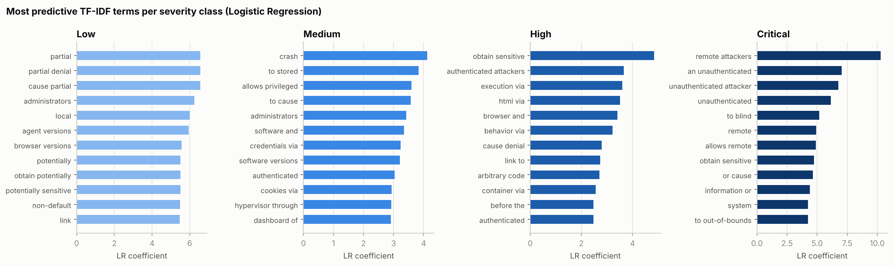

# Predicting Vulnerability Severity from CVE Descriptions with TF-IDF and Linear Models: A Controlled Study on Synthetic CVSS-Grounded Data

*Code, data and all reported numbers: this repository (`python -m src.run_pipeline`).*

## Abstract

Analysts must assign a severity to every newly disclosed vulnerability, but
CVSS scores often arrive days or weeks after the CVE description is published.
We study how well a vulnerability's qualitative CVSS v3.1 severity (Low,
Medium, High, Critical) can be predicted from its description alone, using
lightweight, interpretable models. To get ground truth whose relationship to
the text is known exactly, we build a synthetic corpus of 8,000 CVE-style
descriptions. For each record we sample a latent CVSS v3.1 vector from a
weakness-specific distribution, label it with the official base-score equations,
and render text that reveals each metric only partially. We add 5%
analyst-disagreement noise. We compare a majority baseline, Complement Naive
Bayes, logistic regression, a linear SVM and a random forest on TF-IDF
features, tuning with 5-fold cross-validation and evaluating on a stratified
held-out test set of 1,600 records. Logistic regression is best on
cross-validated macro-F1 (0.625). On the test set it reaches 0.694 accuracy
and 0.649 macro-F1 (95% bootstrap CI 0.620–0.676), against 0.426 and 0.149 for
the majority baseline. Its advantage over the random forest (0.698 accuracy,
0.639 macro-F1) is not statistically reliable. 90.6% of its errors are off by
one severity level, and only 2.9% of test predictions are two or more levels
off. A classifier given the true CVSS metrics reaches 0.997 accuracy, so the
remaining error comes from information missing from the descriptions, not from
model capacity. Terms that mention unauthenticated remote attackers predict
Critical, and terms such as "partial denial" or "potentially sensitive" predict
Low.

## 1. Introduction

The Common Vulnerabilities and Exposures (CVE) programme publishes tens of
thousands of new vulnerability records per year [1, 3]. Each record has a short
English description. The U.S. National Vulnerability Database (NVD) then
enriches records with a Common Vulnerability Scoring System (CVSS) vector and
base score [2, 4]. Defenders use the resulting severity rating (Low, Medium,
High, Critical) to triage patching. The rating is often missing exactly when
it is most needed, shortly after disclosure, because scoring is manual and
NVD's enrichment backlog has at times grown to many thousands of records.

Predicting severity directly from the description is a natural text
classification problem. It has been studied with bag-of-words models [7, 8],
multi-target models [9] and transformer encoders [10]. Results on real NVD data
are hard to interpret for two reasons. First, the ground truth is noisy: human
analysts disagree, and scoring practice drifts over time [8, 12]. Second, we
never know how much of the label is recoverable from the text at all.

This paper makes three contributions:

1. **A documented, CVSS-grounded synthetic benchmark.** Labels come from
   sampled CVSS v3.1 vectors through the official equations, and descriptions
   reveal each metric only with a known probability. The ceiling of
   text-based prediction can therefore be measured, not guessed.
2. **A reproducible comparison of classical models** (Naive Bayes, logistic
   regression, linear SVM, random forest) on TF-IDF features. It reports
   macro-averaged and per-class metrics, bootstrap confidence intervals and
   ordinal error statistics.
3. **An analysis of what the models learn and where they fail.** We show the
   most predictive n-grams per class, a feature-representation ablation,
   per-weakness accuracy, and the gap to an oracle that sees the true vector.

The full pipeline runs in about 3 minutes on a laptop-class CPU with
numpy, pandas, scikit-learn and matplotlib only.

## 2. Background

### 2.1 CVE, CWE and NVD

A CVE record identifies one publicly disclosed vulnerability and gives a short
description. These descriptions are typically formulaic: *"<weakness> in
<component> in <product> <versions> allows <actor> to <impact> via <vector>."*
The Common Weakness Enumeration (CWE) classifies the underlying flaw type,
e.g. CWE-79 cross-site scripting or CWE-89 SQL injection [5]. NVD adds CVSS
vectors, CWE mappings and affected-product (CPE) data to CVE records [4].

### 2.2 CVSS and severity scoring

CVSS v3.1 [2] describes a vulnerability's intrinsic characteristics with eight
*base metrics*. Four are **exploitability** metrics: Attack Vector (AV:
Network, Adjacent, Local, Physical), Attack Complexity (AC: Low, High),
Privileges Required (PR: None, Low, High) and User Interaction (UI: None,
Required). One is **Scope** (S: Unchanged, Changed). Three are **impact**
metrics: Confidentiality, Integrity and Availability (C/I/A: High, Low, None).
A closed-form equation combines the metric weights into a base score in
[0, 10]. The score maps to qualitative ratings: None (0.0), Low (0.1–3.9),
Medium (4.0–6.9), High (7.0–8.9) and Critical (9.0–10.0). For example,
`AV:N/AC:L/PR:N/UI:N/S:U/C:H/I:H/A:H` (unauthenticated remote code execution)
scores 9.8, Critical. A typical reflected XSS, `AV:N/AC:L/PR:N/UI:R/S:C/C:L/I:L/A:N`,
scores 6.1, Medium. The score is a deterministic, non-linear function of the
metrics with strong interactions. For instance, PR weights depend on Scope, and
impact saturates. CVSS has well-known critiques: its scores correlate weakly
with actual exploitation [11, 12, 13], and it was revised as v4.0 in 2023 [14].
It remains the dominant severity signal in practice.

### 2.3 NLP for security text

Early work by Bozorgi et al. [6] used bag-of-words features from vulnerability
databases to predict exploitation with linear SVMs. Han et al. [7] predicted
NVD severity from descriptions with word embeddings and a shallow CNN. Le et
al. [8] showed that vulnerability-assessment models degrade under *concept
drift*, as new vocabulary appears over time, and that character n-grams help.
Spanos and Angelis [9] predicted individual CVSS metrics from text with
multi-target classifiers. Shahid and Debar [10] fine-tuned BERT per CVSS metric
and reconstructed the score. Le et al. [15] survey the area. A recurring
finding is that well-tuned linear models on TF-IDF features are strong,
cheap baselines for short, formulaic security text. That motivates our model
set.

## 3. Problem Formulation

Given a description *x*, predict *y* ∈ {Low, Medium, High, Critical}. Records
with CVSS score 0.0 ("None") are excluded. The classes are ordered and
imbalanced, so we use **macro-F1** as the primary metric: it weights the rare
Low and Critical classes equally with the frequent ones. Accuracy, macro
precision/recall and ordinal error statistics are secondary metrics.

## 4. Methodology

### 4.1 Synthetic CVSS-grounded dataset

We did not use real NVD data because it cannot be reliably downloaded in bulk
without authentication within our runtime budget. We built a generator
(`src/generate_data.py`) that reproduces the *causal structure* of real
records: description and severity are both consequences of an underlying
vulnerability, and severity is computed from a CVSS vector, not from words.
For each record:

1. **Weakness family.** We sample one of 19 CWE-like families. Prior weights
   roughly follow NVD frequencies, e.g. XSS 16, memory corruption 13, DoS 13,
   information disclosure 12, SQL injection 10, privilege escalation 7, OS
   command injection 6, authentication bypass 6, down to XXE and hard-coded
   credentials at 2.
2. **Latent CVSS vector.** Each of the eight base metrics is sampled
   independently from a family-specific categorical distribution. Defaults
   apply where a family leaves a metric unspecified. Families encode domain
   knowledge, for example XSS → `UI:R`, `S:C` (92%), `C:L/I:L`; privilege
   escalation → `AV:L` (90%), `PR:L`; DoS → `C:N/I:N`, `A:H` (75%) or `A:L`.
   The generic "improper input validation" family uses the broad default
   distribution, so its severity is hard to predict.
3. **Label.** We compute the base score with the official CVSS v3.1 equations
   (`src/cvss.py`, verified against 11 reference vectors in
   `tests/test_cvss.py`) and map it to a severity band. Vectors scoring 0.0 are
   re-drawn.
4. **Rendering with partial observability.** The description is assembled from
   phrase pools. An *actor* phrase revealing AV and PR ("unauthenticated remote
   attackers", "local users", "physically proximate attackers") is used with
   probability 0.8. Otherwise a generic "an attacker" is used. A *vector*
   phrase revealing UI ("via a crafted HTTP request" vs. "by convincing a user
   to open a crafted file") is used with probability 0.75. An AC:H caveat
   (", if a non-default configuration is enabled") is used with probability
   0.7. A Scope-changed phrase ("and escape the sandbox") is used with
   probability 0.5. The *impact* phrase is family-specific ("inject arbitrary
   web script or HTML") or derived from the C/I/A profile ("cause a partial
   denial of service", "obtain sensitive information"). One of four templates
   is chosen. Three mimic NVD, "An issue was discovered in…", and advisory
   styles. The fourth (10%) is vague and reveals almost nothing: "A
   vulnerability in the packet parser of X … may lead to a security impact."
5. **Analyst-disagreement noise.** With probability 0.05, one metric (PR, UI,
   C, I, A or AC) is re-sampled from the default distribution *after*
   rendering, and the label is recomputed. This creates text–label
   inconsistencies like those seen when NVD analysts score differently from
   what a description suggests.
6. **Nuisance tokens.** Vendor and product names are random 4–5-syllable
   pseudo-words, together with product kinds and version strings. They carry
   no signal and refer to no real software. Exact-duplicate descriptions are
   dropped.

With seed 42 the generator produces 8,000 records (Figure 1): **Low 385
(4.8%), Medium 3,412 (42.6%), High 3,103 (38.8%), Critical 1,100 (13.8%)**.
374 records (4.7%) carry injected label noise. Because Low and Critical are
much rarer than Medium and High, as in real CVSS v3 data, the task is
moderately imbalanced. Each row stores the description, weakness family, CWE
id, CVSS vector, base score and severity, so the data are fully auditable.

*Figure 1. Severity class distribution (n = 8,000).*

### 4.2 Text representation

Descriptions are lower-cased and converted to TF-IDF vectors [17]. The default
representation uses word unigrams and bigrams, sublinear term frequency
(1 + log tf), `min_df = 2`, `max_df = 0.95`, and a token pattern that requires
an alphabetic first character, so version numbers are discarded. On the
training split this yields 2,624 features. The ablation (Section 5.4) also
evaluates unigrams only, 1–3-grams, character 3–5-grams within word boundaries
[8], and the concatenation of word 1–2-grams and character 3–5-grams.

### 4.3 Classifiers

All models are scikit-learn pipelines (`TfidfVectorizer → classifier`) [16].
The vectoriser is therefore re-fit inside every cross-validation fold, and no
test-set statistics leak into training.

* **Majority baseline**: always predicts the most frequent class (Medium).
* **Complement Naive Bayes** [18]: a Naive Bayes variant suited to imbalanced
  text data. Smoothing α ∈ {0.1, 0.3, 1.0}.
* **Logistic regression**: multinomial, L2-regularised, lbfgs solver,
  `class_weight = balanced`, C ∈ {1, 4, 16}.
* **Linear SVM**: one-vs-rest hinge loss (LIBLINEAR [20]),
  `class_weight = balanced`, C ∈ {0.1, 0.3, 1.0}.
* **Random forest** [19]: 300 trees, `class_weight = balanced_subsample`,
  `min_samples_leaf` ∈ {1, 2}.

### 4.4 Experimental protocol

The 8,000 records are split 80/20, stratified by severity, into a training set
(6,400) and a held-out test set (1,600: Low 77, Medium 682, High 621, Critical
220). Hyper-parameters are chosen by grid search with 5-fold stratified
cross-validation on the training set, maximising macro-F1. The best
configuration is refit on the full training set and evaluated once on the test
set. **The "best model" is chosen by cross-validated macro-F1, not by test
performance.**

For the test set we report accuracy, macro precision/recall/F1, weighted F1,
per-class precision/recall/F1 and the confusion matrix. Because the labels are
ordinal, we also report the **ordinal MAE**, the mean absolute difference
between true and predicted class index; the **share of errors that are off by
one level**; and the **severe-error rate**, the fraction of test records
predicted two or more levels away. Ninety-five per cent confidence intervals
come from 1,000 percentile-bootstrap resamples of the test set [21]. We compare
models with a paired bootstrap: the fraction of resamples in which model A's
macro-F1 exceeds model B's.

Three further analyses complete the study:
(i) a TF-IDF feature ablation with the tuned logistic regression;
(ii) an **oracle** logistic regression trained on one-hot-encoded *true* CVSS
metrics and all their pairwise combinations, which measures how much of the
label is determined by the vector; and
(iii) accuracy on the vague-template and label-noise test subsets, and per
weakness family.

All randomness flows from one seed (42). The complete pipeline
(`python -m src.run_pipeline`) took 187 s on a 4-vCPU container. The random
forest grid search was the most expensive step at 59 s.

## 5. Experiments and Results

### 5.1 Model comparison

**Table 1.** Cross-validated (training) and held-out test performance. Brackets: 95% bootstrap CI.

| Model | Best hyper-params | CV macro-F1 (± sd) | Test accuracy | Macro-P | Macro-R | Macro-F1 | Weighted F1 |
|---|---|---|---|---|---|---|---|
| Majority baseline | – | 0.150 ± 0.000 | 0.426 [0.401, 0.451] | 0.107 | 0.250 | 0.149 [0.143, 0.156] | 0.255 |
| Complement NB | α = 0.1 | 0.466 ± 0.016 | 0.618 [0.592, 0.640] | 0.455 | 0.460 | 0.452 [0.429, 0.475] | 0.610 |
| **Logistic regression** | C = 16 | **0.625 ± 0.015** | 0.694 [0.672, 0.718] | 0.621 | **0.713** | **0.649** [0.620, 0.676] | **0.701** |
| Linear SVM | C = 1 | 0.610 ± 0.014 | 0.684 [0.662, 0.708] | 0.611 | 0.674 | 0.634 [0.604, 0.662] | 0.688 |
| Random forest | min_samples_leaf = 2 | 0.612 ± 0.013 | **0.698** [0.675, 0.719] | **0.638** | 0.641 | 0.639 [0.609, 0.670] | 0.698 |

All three discriminative models beat the majority baseline by a wide margin:
+0.26–0.27 accuracy and about +0.49 macro-F1. They also beat Complement NB by
+0.07–0.08 accuracy and +0.18–0.20 macro-F1 (Table 1, Figure 2). Logistic
regression has the highest cross-validated macro-F1 and is selected as the
best model. On the test set it also has the highest macro-F1 (0.649) and macro
recall (0.713). The random forest has marginally higher accuracy (0.698) and
macro precision (0.638). The three discriminative models are close. In the
paired bootstrap, logistic regression's macro-F1 exceeds the linear SVM's in
94.2% of resamples, but the random forest's in only 77.3%. Their confidence
intervals overlap substantially. We therefore treat logistic regression, the
linear SVM and the random forest as statistically comparable. Logistic
regression has the practical advantage of being 5–6× faster to tune than the
forest (10 s vs. 59 s) and directly interpretable. Logistic regression beats
Complement NB and the baseline in 100% of resamples.

*Figure 2. Held-out test accuracy and macro-F1 per model with 95% bootstrap confidence intervals.*

### 5.2 Per-class performance and confusion structure

**Table 2.** Per-class test precision / recall / F1 (support: Low 77, Medium 682, High 621, Critical 220).

| Model | Low P / R / F1 | Medium P / R / F1 | High P / R / F1 | Critical P / R / F1 |
|---|---|---|---|---|
| Complement NB | 0.095 / 0.026 / 0.041 | 0.736 / 0.733 / 0.735 | 0.604 / 0.618 / 0.611 | 0.386 / 0.464 / 0.422 |
| Logistic regression | 0.400 / 0.727 / 0.516 | 0.810 / 0.698 / 0.750 | 0.728 / 0.660 / 0.693 | 0.547 / 0.768 / 0.639 |
| Linear SVM | 0.416 / 0.610 / 0.495 | 0.777 / 0.721 / 0.748 | 0.705 / 0.638 / 0.670 | 0.548 / 0.727 / 0.625 |
| Random forest | 0.506 / 0.520 / 0.513 | 0.779 / 0.739 / 0.758 | 0.677 / 0.710 / 0.693 | 0.587 / 0.596 / 0.591 |

Medium is the easiest class (F1 0.75–0.76 for the discriminative models) and
Low the hardest (F1 ≈ 0.50–0.52). Complement NB effectively never predicts Low
(recall 0.026), which explains its low macro-F1. Balanced class weights make
logistic regression favour **recall on the minority classes**: Low recall
0.727, Critical 0.768. The price is precision: 0.400 and 0.547 respectively.
The random forest makes the opposite trade-off. It has higher Low and Critical
precision but recall of only 0.520 and 0.596. For triage, missing a Critical
vulnerability is usually costlier than over-escalating a High one, so the
logistic-regression operating point is the more useful default.

The confusion matrix of the best model (Figure 3) is close to **band-diagonal**.
Of its 489 test errors, 90.6% fall in an adjacent class. The most frequent
confusions are High → Critical (114), Medium → High (106), High → Medium (87)
and Medium → Low (74). No Critical record is predicted Low, and no Low record
is predicted Critical. The model's ordinal MAE is 0.334 and its severe-error
rate (≥ 2 levels off) is 2.9% (46 of 1,600). The random forest has 1.8% and
the linear SVM 2.3%. The majority baseline has 13.8%.

*Figure 3. Row-normalised test confusion matrix of the selected model (logistic regression); cells show counts and row percentages.*

### 5.3 What the model learns

Figure 4 lists the n-grams with the largest logistic-regression coefficient for
each class. The figure is restricted to n-grams that occur in at least 30
training descriptions, so that rare n-grams with large but unstable weights do
not dominate. The top terms recover CVSS semantics without any supervision on
the metrics themselves:

* **Critical**: "remote attackers", "an unauthenticated", "unauthenticated
  attacker", "allows remote", "system". These are the textual signature of
  `AV:N/PR:N` combined with full impact.
* **High**: "obtain sensitive", "authenticated attackers", "execution via",
  "arbitrary code", "cause denial". These are typical of high-impact issues
  that need privileges, or of single-dimension high impact (C:H or A:H alone,
  e.g. 7.5).
* **Medium**: "crash", "to stored" (stored XSS), "administrators", "allows
  privileged", "authenticated", "cookies via". These cover XSS and
  availability-only impacts, and high-privilege attackers (`PR:H`), which pull
  scores down.
* **Low**: "partial denial", "potentially sensitive", "obtain potentially",
  "local", "non-default", "link". These are limited impact (`C:L` or `A:L`
  only), local attack vector, high attack complexity and user interaction,
  which together drive scores below 4.0.

Some product-kind bigrams also appear, such as "agent versions" or "browser
versions" for Low. They are generated independently of severity, so they are
spurious correlations learned from few examples. They show that even a linear
model overfits some nuisance tokens on the minority class.

*Figure 4. Twelve highest-weighted TF-IDF n-grams per severity class (logistic regression, train document frequency ≥ 30).*

### 5.4 Feature ablation

**Table 3.** Logistic regression (C = 16) with different TF-IDF representations.

| Features | # features | CV macro-F1 (± sd) | Test accuracy | Test macro-F1 |
|---|---|---|---|---|
| word 1-gram | 627 | 0.622 ± 0.012 | 0.685 | 0.638 |
| **word 1–2-gram (default)** | 2,624 | **0.625 ± 0.015** | 0.694 | 0.649 |
| word 1–3-gram | 6,842 | 0.620 ± 0.012 | 0.695 | 0.656 |
| char 3–5-gram | 18,859 | 0.586 ± 0.016 | 0.668 | 0.617 |
| word 1–2 + char 3–5 | 21,483 | 0.620 ± 0.012 | **0.701** | **0.658** |

Word n-gram variants lie within one cross-validation standard deviation of each
other (CV macro-F1 0.620–0.625). Bigrams help slightly on the test set
(+0.011 macro-F1 over unigrams), presumably because phrases like "partial
denial" or "unauthenticated attacker" carry more signal than their parts.
Character n-grams alone are clearly worse (CV 0.586). Adding them to word
n-grams yields the best *test* scores (0.701 / 0.658) but not the best CV
score, so we do not count this as a reliable improvement. The vocabulary of
our generator is closed, so the robustness to unseen words that motivated
character n-grams in [8] cannot show here.

### 5.5 Where the information runs out

**Oracle ceiling.** A logistic regression trained on the *true* CVSS metrics
(one-hot, plus pairwise combinations) reaches 0.997 test accuracy and 0.996
macro-F1. Every remaining confusion is off by one level. Severity is therefore
almost fully determined by the vector. The 0.30 accuracy gap between the text
model (0.694) and the oracle is not a capacity problem: it is the cost of
metrics that the description does not mention.

**Vague descriptions.** On the 164 test records written with the vague template,
logistic-regression accuracy falls to 0.494. On the 1,436 informative records
it is 0.717. With a vague description the model can rely only on the component
name, such as "the kernel driver" or "the packet parser", which carries a weak
weakness-family prior.

**Label noise.** On the 77 test records with injected analyst-disagreement
noise, accuracy is 0.649, against 0.697 on the 1,523 clean records. The gap is
small because re-sampling a single metric often leaves the severity band
unchanged.

**Per weakness family** (`results/error_by_vuln_class.csv`). Accuracy is
highest for families with concentrated severity distributions: open redirect
0.917, XSS 0.815, privilege escalation 0.811. It is lowest for families whose
severity depends on metrics that are rarely verbalised: physical/side-channel
0.500, XXE 0.516, CSRF 0.520, improper input validation 0.553, SSRF 0.559.
For XXE and SSRF, the C/I/A profile is often only hinted at by the impact
phrase, and Scope is rarely mentioned. For the generic input-validation family,
the text says little beyond "mishandles certain input".

## 6. Discussion and Limitations

**Interpretation.** Severity prediction from descriptions works best as a
*coarse triage signal*. A TF-IDF linear model reaches about 0.69 accuracy and
0.65 macro-F1 and rarely makes large ordinal mistakes (2.9% severe errors),
but about one in three predictions is off by one level. Our controlled setting
shows that this ceiling comes from the data, not the model. Descriptions
under-specify CVSS: they rarely state Scope, often omit whether user
interaction or privileges are needed, and describe impact loosely. Bigger
models cannot recover information that is not in the input. This is
consistent with prior real-data work, where reported gains from deep models
over linear baselines are often small [7, 8, 10]. A promising direction
suggested by our oracle analysis is to predict the individual CVSS metrics
[9, 10] and compute the score from them. Each metric prediction is then
interpretable and can be checked by an analyst.

**Model choice.** Logistic regression, the linear SVM and the random forest
are statistically indistinguishable on accuracy and macro-F1. Logistic
regression is preferable in practice. It tunes in seconds, provides calibrated
probabilities (useful for flagging low-confidence cases for human review), and
its coefficients map directly to explanations (Figure 4). Class weighting is a
decision with operational consequences: it moves the operating point toward
recall on Critical, which suits triage but increases false escalations.

**Limitations.**

1. *Synthetic data.* The main limitation is that the corpus is generated. The
   vocabulary is closed, with a few hundred phrase variants. Templates are
   cleaner than real NVD prose. Metrics are sampled independently given the
   weakness family, whereas real metrics are correlated with each other and
   with product type. Absolute numbers should not be read as estimates of
   performance on real CVEs. Real data adds vocabulary drift over time [8],
   inconsistent scoring practices and much longer-tailed weakness types. The
   value of this study is the *controlled* comparison and the
   information-ceiling analysis, which real data cannot provide.
2. *Generator assumptions drive the results.* The revelation probabilities
   (0.70–0.80), the 10% vague-template rate and the 5% noise rate were set by
   hand to resemble the informativeness of real descriptions. Different
   choices would move every number. The generator is short and fully
   documented, so these assumptions can be inspected and varied.
3. *Nuisance-token overfitting.* Even with random product names that rarely
   repeat, the model assigns weight to product-kind n-grams on the Low class.
   This is a small-sample effect that real vendor names, which genuinely
   correlate with severity, would make larger and harder to detect.
4. *Single split and seed.* Results come from one stratified split, with
   bootstrap CIs for test-set sampling variance and CV standard deviations for
   training variance. Variance across generator seeds was not measured.
5. *Narrow model family.* No transformers or embeddings were used, by design
   (CPU-only, under 10 minutes). Probability calibration and ordinal-regression
   formulations were not explored either.
6. *CVSS itself.* Predicting CVSS severity inherits CVSS's limitations as a
   risk measure [11, 12, 13]. Severity is not exploitability, and complementary
   signals such as EPSS [13] should be used for prioritisation.

## 7. Conclusion

We built a reproducible, CPU-only pipeline for predicting CVSS v3.1 severity
from vulnerability descriptions. It uses a synthetic corpus whose labels are
computed from latent CVSS vectors with the official equations. TF-IDF with
class-weighted logistic regression gave the best cross-validated macro-F1
(0.625). On held-out data it scored 0.694 accuracy and 0.649 macro-F1, about
four times the majority baseline's macro-F1. It was statistically on par with
a linear SVM and a random forest, and 90.6% of its errors were off by only one
severity level. The learned features recover the logic of CVSS: unauthenticated
remote attackers indicate Critical, and partial or potential impact indicates
Low. A classifier given the true vector is nearly perfect, so the errors that
remain are caused by information absent from the text, not by model capacity.
Future work should evaluate the same protocol on time-split real NVD data,
predict individual CVSS metrics instead of the aggregated band, and measure
sensitivity to the generator's revelation probabilities.

## References

[1] MITRE Corporation. *Common Vulnerabilities and Exposures (CVE)*. https://www.cve.org/

[2] FIRST. *Common Vulnerability Scoring System v3.1: Specification Document*. Forum of Incident Response and Security Teams, 2019. https://www.first.org/cvss/v3.1/specification-document

[3] CVE Program. *CVE Program Metrics*. https://www.cve.org/About/Metrics

[4] NIST. *National Vulnerability Database (NVD)*. https://nvd.nist.gov/

[5] MITRE Corporation. *Common Weakness Enumeration (CWE)*. https://cwe.mitre.org/

[6] M. Bozorgi, L. K. Saul, S. Savage, G. M. Voelker. "Beyond Heuristics: Learning to Classify Vulnerabilities and Predict Exploits." In *Proc. 16th ACM SIGKDD International Conference on Knowledge Discovery and Data Mining (KDD)*, 2010.

[7] Z. Han, X. Li, Z. Xing, H. Liu, Z. Feng. "Learning to Predict Severity of Software Vulnerability Using Only Vulnerability Description." In *Proc. IEEE International Conference on Software Maintenance and Evolution (ICSME)*, 2017.

[8] T. H. M. Le, B. Sabir, M. A. Babar. "Automated Software Vulnerability Assessment with Concept Drift." In *Proc. 16th International Conference on Mining Software Repositories (MSR)*, 2019.

[9] G. Spanos, L. Angelis. "A Multi-Target Approach to Estimate Software Vulnerability Characteristics and Severity Scores." *Journal of Systems and Software*, 146, 2018.

[10] M. R. Shahid, H. Debar. "CVSS-BERT: Explainable Natural Language Processing to Determine the Severity of a Computer Security Vulnerability from its Description." In *Proc. 20th IEEE International Conference on Machine Learning and Applications (ICMLA)*, 2021.

[11] L. Allodi, F. Massacci. "Comparing Vulnerability Severity and Exploits Using Case-Control Studies." *ACM Transactions on Information and System Security*, 17(1), 2014.

[12] J. Spring, E. Hatleback, A. Householder, A. Manion, D. Shick. "Time to Change the CVSS?" *IEEE Security & Privacy*, 19(2), 2021.

[13] J. Jacobs, S. Romanosky, B. Edwards, I. Adjerid, M. Roytman. "Exploit Prediction Scoring System (EPSS)." *Digital Threats: Research and Practice*, 2(3), 2021.

[14] FIRST. *Common Vulnerability Scoring System v4.0: Specification Document*. 2023. https://www.first.org/cvss/v4.0/specification-document

[15] T. H. M. Le, H. Chen, M. A. Babar. "A Survey on Data-driven Software Vulnerability Assessment and Prioritization." *ACM Computing Surveys*, 55(5), 2022.

[16] F. Pedregosa et al. "Scikit-learn: Machine Learning in Python." *Journal of Machine Learning Research*, 12, 2011.

[17] G. Salton, C. Buckley. "Term-Weighting Approaches in Automatic Text Retrieval." *Information Processing & Management*, 24(5), 1988.

[18] J. D. M. Rennie, L. Shih, J. Teevan, D. R. Karger. "Tackling the Poor Assumptions of Naive Bayes Text Classifiers." In *Proc. 20th International Conference on Machine Learning (ICML)*, 2003.

[19] L. Breiman. "Random Forests." *Machine Learning*, 45(1), 2001.

[20] R.-E. Fan, K.-W. Chang, C.-J. Hsieh, X.-R. Wang, C.-J. Lin. "LIBLINEAR: A Library for Large Linear Classification." *Journal of Machine Learning Research*, 9, 2008.

[21] B. Efron, R. J. Tibshirani. *An Introduction to the Bootstrap*. Chapman & Hall/CRC, 1993.
